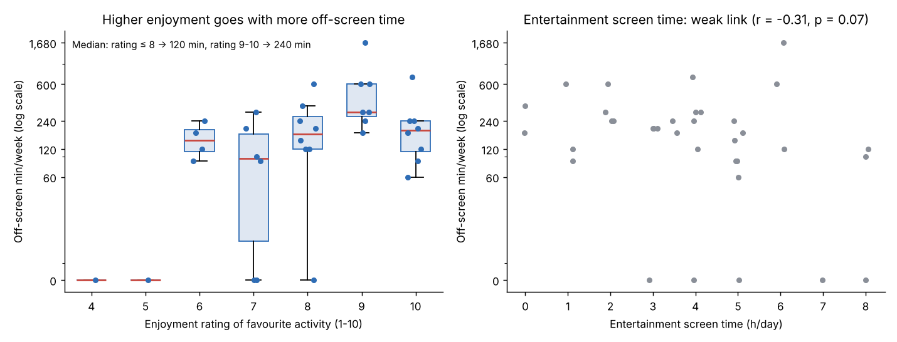
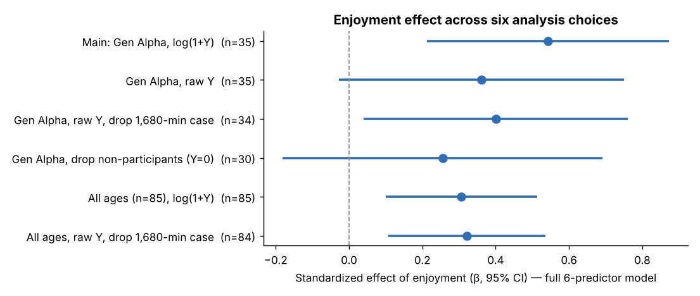

# What Gets Gen Alpha Off the Screen?

**Survey analysis with multiple regression.** Which factors relate to how much time Generation Alpha children spend on off-screen activities such as sports, art and outdoor play? Real Google Forms responses were analysed in Python and Minitab: data cleaning, a transformed response, backward elimination, assumption checks with a fallback when they fail, and a robustness check across six analysis choices.

> Course project · 2104202 Statistics for Engineering II · Industrial Engineering, Chulalongkorn University · AY 2568 (2026) · team of 3



## Key findings

1. **Enjoyment is the only consistent predictor.** Each extra point of enjoyment (1–10 scale) goes with about **+86 %** more weekly off-screen time (95 % CI +27 % to +171 %, p = 0.002; bootstrap CI also excludes zero). The effect is positive in all six model variants and significant in four of them.
2. **Enjoyment mainly decides *whether* children take part, not *how long*.** The 5 children with zero off-screen minutes rated their activity 6.2/10 on average, vs 8.4 for participants (Mann–Whitney p = 0.014). Among participants alone, the link between enjoyment and minutes is weak (Spearman ρ = 0.18, p = 0.35).
3. **Screen time, parental support and friends show no reliable effect.** Entertainment screen time correlates weakly and negatively with off-screen time (r = −0.31, p = 0.07) but adds nothing once enjoyment is in the model (p = 0.92). Weather is borderline (p = 0.08).
4. **Explained variance is modest, as expected for self-reported behaviour.** The final model has R² = 32.8 % (adjusted 28.6 %, predicted 21.3 %). Cross-validated error beats a mean-only baseline by about 12 %.

**Practical takeaway:** to get children off screens, the first lever is an activity they genuinely enjoy. Restricting screens or adding more friends to the activity is not supported by this sample.

## Data

| | |
|---|---|
| Source | Google Forms, 23–25 April 2026, convenience sample (online share) |
| Responses | 85 → **35 Gen Alpha** after excluding 50 respondents aged 19+ |
| Response (Y) | Off-screen recreation in the last 7 days, minutes. Range 0–1,680, median 180, skewness 3.1 |
| Predictors | X1 enjoyment (1–10) · X2 good weather (dummy) · X3 friends joining · X4 parental support (1–5) · X5 entertainment screen h/day · X6 study screen h/day |

`data/raw/survey_responses.csv` holds the anonymised form export (timestamps removed). `src/clean.py` produces `data/processed/survey_coded.csv`. See [`data/data_dictionary.md`](data/data_dictionary.md).

## Method

```
raw form export → code answers (weather → dummy, age band → Gen Alpha flag)
  → descriptive stats & distributions → Y is heavily right-skewed with zeros → model log(1 + Y)
  → Pearson correlation → full 6-predictor model → backward elimination (α-to-remove 0.10)
  → assumption checks → normality/variance borderline → bootstrap CIs (5,000 resamples)
  → 5-fold cross-validation → robustness across 6 specifications → participation analysis
```

**Why log(1 + Y)?** Weekly minutes range from 0 to 1,680 with skewness 3.1, and one respondent alone dominates a raw-scale model. The log transform keeps every respondent, pulls in the long tail, and lets coefficients be read as approximate percentage changes. Raw-scale models are reported as sensitivity checks.

### Backward elimination

| Step | Removed | R² | R²(adj) | Mallows' Cp | BIC |
|---|---|---|---|---|---|
| 1 | — (all 6) | 40.1 % | 27.3 % | 7.00 | 158.3 |
| 2 | Entertainment screen (p = 0.92) | 40.1 % | 29.8 % | 5.01 | 154.7 |
| 3 | Study screen (p = 0.69) | 39.8 % | 31.7 % | 3.17 | 151.4 |
| 4 | Friends (p = 0.30) | 37.5 % | 31.5 % | 2.22 | 149.1 |
| 5 | Parental support (p = 0.14) | 32.8 % | 28.6 % | 2.41 | **148.1** |

### Final model: `log(1 + Y) = −0.73 + 0.620·Enjoyment + 1.126·GoodWeather`

| Term | Coef | SE | p | 95 % CI | Bootstrap 95 % CI | VIF |
|---|---|---|---|---|---|---|
| Enjoyment | 0.620 | 0.186 | **0.002** | 0.24 – 1.00 | 0.20 – 0.95 | 1.01 |
| Good weather | 1.126 | 0.626 | 0.082 | −0.15 – 2.40 | 0.22 – 2.07 | 1.01 |

### Assumption checks

| Check | Result | Handling |
|---|---|---|
| Normal residuals | Shapiro–Wilk p = 0.02; A² = 0.88 (> 0.74) ✗ | The five zero-minute children create a lower cluster. Inference is backed by bootstrap CIs, which do not assume normality |
| Constant variance | Breusch–Pagan p = 0.045 (borderline) | Same: bootstrap CIs |
| Independence | Durbin–Watson = 2.16 ✔ | |
| Multicollinearity | max VIF = 1.68 (full model) ✔ | |
| Influence | max Cook's D = 0.13 ✔ | |

### Robustness of the enjoyment effect



The enjoyment effect stays positive in every variant. It loses significance in two of them: raw Y with all 35 children, where one extreme value inflates the noise, and the 30-child sample that excludes non-participants. The second result is what points to finding 2: enjoyment acts mainly on whether a child participates at all.

## Limitations

- **Small, convenience sample.** n = 35 gives limited power: medium-sized effects for screen time or parental support could exist and still go undetected. 59 % of all respondents were adults (19+), so the survey reached its target population poorly.
- **Self-reported, cross-sectional data.** All measures come from the same questionnaire, so the results show association, not causation. Children who already spend time offline may simply rate their activity as more enjoyable.
- **Survey design.** Enjoyment and weather refer to the respondent's favourite activity and the past week, which only roughly match the outcome. A future survey should measure time per activity, use screen-time app readings, and target parents of children under 16 directly.

## Reproduce

```bash
pip install -r requirements.txt
python src/clean.py          # raw export → data/processed/survey_coded.csv
python src/run_analysis.py   # tables → results/ (see results/summary.md), charts → figures/
```

**Minitab:** open `minitab/offscreen_minitab_data.xlsx` (sheet `GenAlpha_n35`), run `minitab/run_analysis.mtb` via *File › Run an Exec*, then save the project as `.mpx`.

`src/stats_tools.py` implements OLS, Minitab-style backward elimination, VIF, AICc/BIC/Mallows' Cp, PRESS, Breusch–Pagan, Cook's distance and k-fold CV with numpy/scipy, so every number can be traced to its formula and checked against Minitab.

## Repository layout

```
├── data/raw/survey_responses.csv        anonymised Google Forms export (85 rows)
├── data/processed/survey_coded.csv      coded data + Gen Alpha flag + log(1+Y)
├── src/clean.py                         coding rules
├── src/stats_tools.py                   regression toolkit
├── src/run_analysis.py                  full pipeline
├── results/                             CSV tables + summary.md
├── figures/                             distributions, correlations, residuals, robustness
└── minitab/                             Minitab-ready workbook + exec macro
```

**Provenance note:** all results here are recomputed from the raw form responses. The figures in the original course report came from a worksheet that does not match these responses, so they are not reproduced here.

---

### สรุปภาษาไทย

วิเคราะห์ข้อมูลจริงจากแบบสอบถาม 85 คน คัดเฉพาะเด็กเจนอัลฟาเหลือ 35 คน แปลงตัวแปรตามเป็น log(1+Y) เพราะข้อมูลเบ้มาก จากนั้นทำ Backward Elimination พบว่าความสนุกของกิจกรรมเป็นปัจจัยเดียวที่มีผลสม่ำเสมอ: ทุก 1 คะแนนเพิ่มเวลาทำกิจกรรมนอกจอราว 86% (p = 0.002) และมีผลหลักต่อการที่เด็กจะ "ออกไปทำกิจกรรมหรือไม่" มากกว่าระยะเวลาที่ทำ ส่วนเวลาหน้าจอ การสนับสนุนจากผู้ปกครอง และจำนวนเพื่อนไม่มีผลอย่างมีนัยสำคัญ (R² = 32.8%) มีการตรวจ assumption, ใช้ bootstrap CI แทนเมื่อ normality ไม่ผ่าน และทดสอบความทนทานของผลใน 6 รูปแบบการวิเคราะห์
